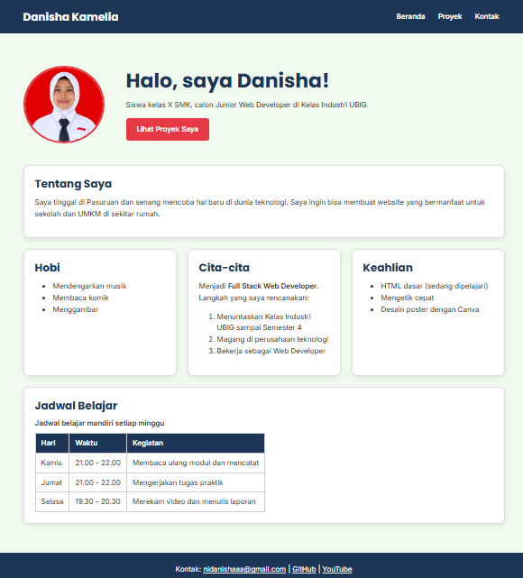

# Portofolio Danisha Kamelia

Website portofolio pribadi yang saya buat
di Kelas Industri UBIG.

Website ini menampilkan profil pribadi,
tentang saya, keahlian, proyek, dan kontak.

## Tampilan

## Fitur

- Halaman Beranda berisi foto profil dan informasi pribadi.
- Halaman Tentang Saya berisi deskripsi diri.
- Halaman Proyek menampilkan hasil karya.
- Halaman Kontak menyediakan formulir pesan.
- Mode gelap dan mode terang.
- Tampilan responsif untuk HP, tablet, dan laptop.

## Teknologi

- HTML5
- CSS3
- JavaScript
- JSON
- Git dan GitHub
- Vercel

## Skor Lighthouse

Isi dengan hasil pengujian Lighthouse milik sendiri.

## Tautan

- Website: (https://danisha-portofolio.vercel.app/kontak.html)
- GitHub: (https://github.com/danishakamelia224/portofolio)

## Pembuat

Danisha Kamelia